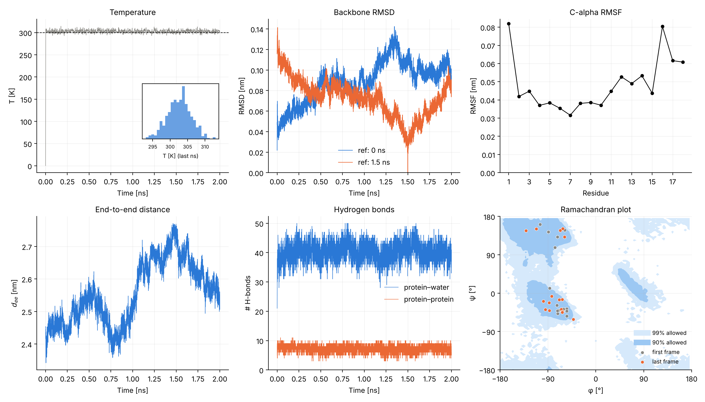
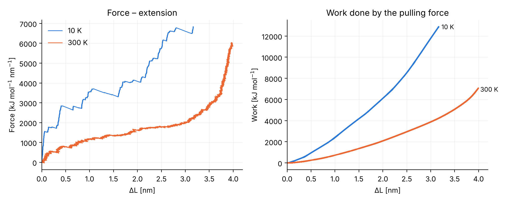

# Molecular dynamics of a peptide in water

Molecular dynamics of the 18-residue peptide **MAP_3** (KLALKLALKALKAALKLA) in explicit water: an **equilibrium simulation** at 300 K and **steered MD** (constant-velocity pulling) at 10 K and 300 K. Simulations were run with **GROMACS**; the analysis is in **Python**.

This is one part of a larger course project (*Multiscale Biomechanics*), which also covered simulations in vacuum, a second peptide and simulated annealing with clustering.

## 1. Equilibrium MD (2 ns, 300 K)



The temperature settles at 300 K within a few ps (302.7 ± 3.4 K over the last ns). The backbone RMSD stays around 0.1 nm and the backbone angles occupy the same regions of the Ramachandran plot (α-helix and extended) in the first and last frame: the structure is stable in water over 2 ns. Fluctuations (RMSF) are largest at the two termini.

## 2. Steered MD: effect of temperature



At 10 K the peptide needs a much higher force and about 3× more work to reach the same extension, and in the same 1 ns of pulling it stretches less (3.2 nm vs 4.0 nm at 300 K). At 300 K thermal motion helps break the intramolecular contacts, while at 10 K they give way in discrete steps, visible as jumps in the force curve.

## Setup
- Force field AMBER99SB-ILDN, TIP3P water, 0.15 M NaCl, v-rescale thermostat
- Equilibrium MD: dodecahedral box, energy minimization, then 2 ns at 300 K
- Steered MD: box elongated along the pulling direction; first residue pulled, last residue restrained; spring k = 1000 kJ mol⁻¹ nm⁻², rate 0.01 nm/ps, 1 ns of pulling; 100 ps equilibration at the target temperature before each pull

## Repository
```
simulation/       GROMACS commands (run_md.sh, run_smd.sh), .mdp parameter files, starting structure
data/md/          GROMACS outputs of the equilibrium MD (temperature, RMSD, RMSF, angles, distance, H-bonds)
data/smd/         pull force (pullf) and COM distance (pullx) at 10 K and 300 K
analysis_md.py    equilibrium-MD figure
analysis_smd.py   computes extension and work from the pull outputs, makes the SMD figure
```

## Run the analysis
```bash
pip install -r requirements.txt
python analysis_md.py
python analysis_smd.py
```
No GROMACS needed: the scripts start from the `.xvg` files in `data/`.

## Notes
- Work is the integral of the pulling force over the COM displacement. A single non-equilibrium pull gives only an upper bound of the free-energy change; estimating ΔG (e.g. with the Jarzynski equality) would need many repeated pulls.
